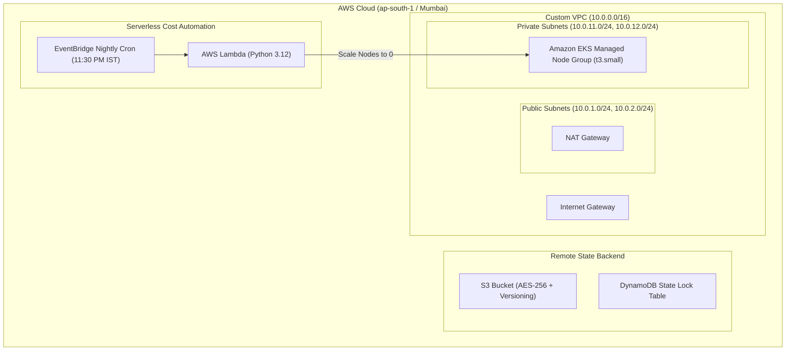
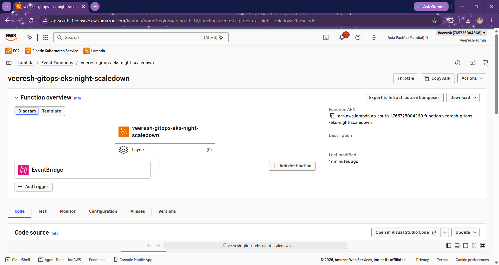

# Enterprise AWS EKS & Serverless FinOps Infrastructure (Terraform IaC)

Production-grade, modular Infrastructure as Code (IaC) repository that provisions a secure Multi-AZ AWS VPC, private Amazon EKS Kubernetes cluster, and an event-driven AWS Lambda FinOps auto-scaler to host the [`gitops-app`](https://github.com) microservice.

## Architecture Overview



## Key Engineering Highlights
- **Modular Terraform Design:** Decoupled reusable modules (`modules/vpc`, `modules/eks`, `modules/lambda-finops`) wired into `environments/dev`.
- **Remote State & Concurrency Locking:** Encrypted S3 backend with DynamoDB state locking (`bootstrap/`).
- **Zero-Trust Network Isolation:** Worker nodes run exclusively inside private subnets across 2 Availability Zones (`ap-south-1a`, `ap-south-1b`) with outbound-only internet via NAT Gateway.
- **Serverless FinOps Automation:** EventBridge triggers a Python AWS Lambda function nightly to scale EKS worker nodes to zero, eliminating idle compute spend.
- **Shift-Left IaC Security:** GitHub Actions CI enforces `terraform fmt`, `terraform validate`, and Checkov static security analysis on every push.

## Live Deployment Verification

### 1. Amazon EKS Cluster (`ap-south-1`)


### 2. Private EKS Worker Node & Running `gitops-app` Microservice Pods


### 3. Serverless AWS Lambda & EventBridge FinOps Auto-Scaler


## Quick Start
```bash
# 1. Bootstrap remote state (S3 + DynamoDB)
cd bootstrap && terraform init && terraform apply

# 2. Provision VPC, EKS Cluster, and Lambda FinOps
cd ../environments/dev && terraform init && terraform apply

# 3. Connect kubectl to EKS
aws eks update-kubeconfig --region ap-south-1 --name veeresh-gitops-eks
```
