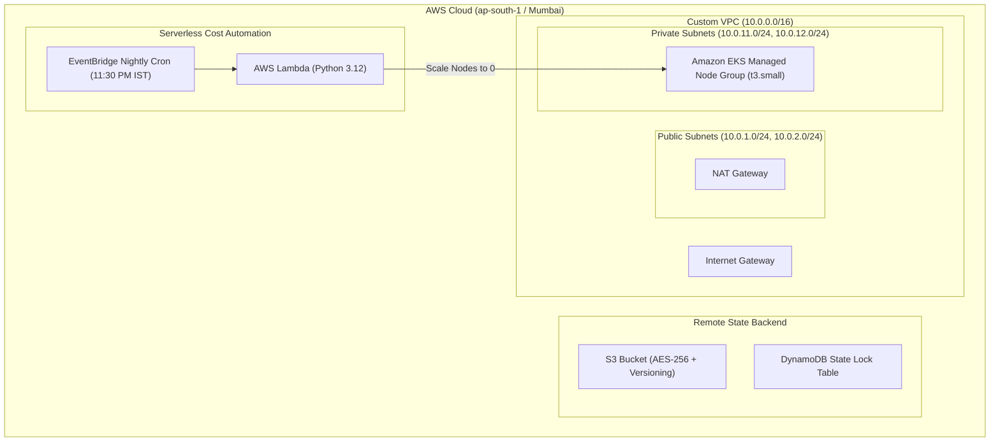
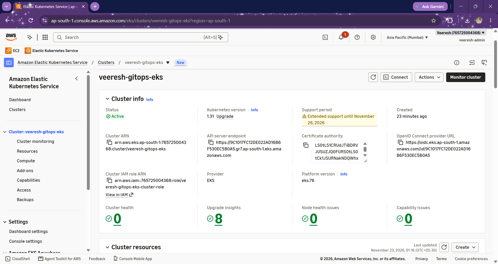
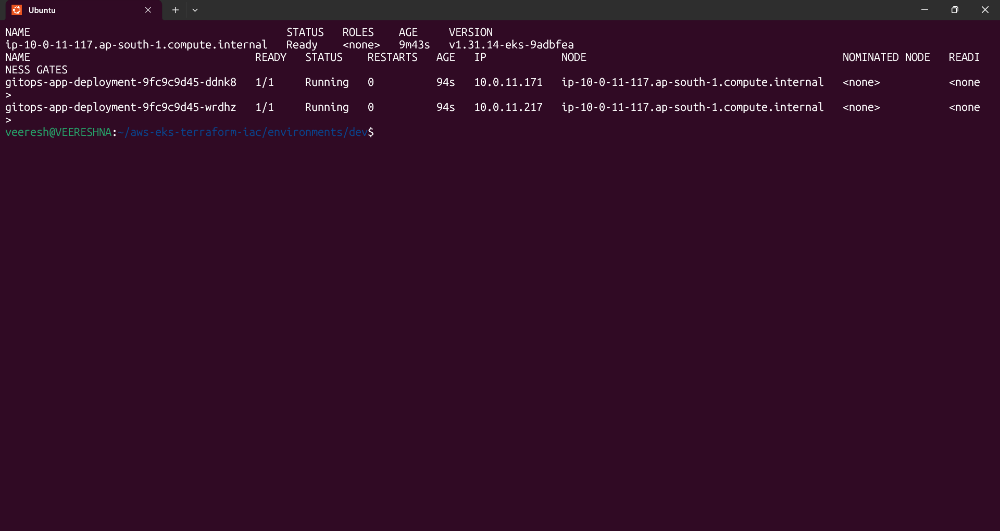

# Enterprise AWS EKS & Serverless FinOps Infrastructure (Terraform IaC)

Production-grade, modular Infrastructure as Code (IaC) repository that provisions a secure Multi-AZ AWS VPC, private Amazon EKS Kubernetes cluster, and an event-driven AWS Lambda FinOps auto-scaler to host the [`gitops-app`](https://github.com/Veeresh-Shetter/gitops-app) microservice.

## Architecture Overview



## Key Engineering Highlights
- **Modular Terraform Design:** Decoupled reusable modules (`modules/vpc`, `modules/eks`, `modules/lambda-finops`) wired into `environments/dev`.
- **Remote State & Concurrency Locking:** Encrypted S3 backend with DynamoDB state locking (`bootstrap/`).
- **Zero-Trust Network Isolation:** Worker nodes run exclusively inside private subnets across 2 Availability Zones (`ap-south-1a`, `ap-south-1b`) with outbound-only internet via NAT Gateway.
- **Serverless FinOps Automation:** EventBridge triggers a Python AWS Lambda function nightly to scale EKS worker nodes to zero, eliminating idle compute spend.
- **Shift-Left IaC Security:** GitHub Actions CI enforces `terraform fmt`, `terraform validate`, and Checkov static security analysis on every push.

## Live Deployment Verification

### 1. Amazon EKS Cluster (`ap-south-1`)


### 2. Private EKS Worker Node & Running `gitops-app` Microservice Pods


### 3. Serverless AWS Lambda & EventBridge FinOps Auto-Scaler


## Quick Start
```bash
# 1. Bootstrap remote state (S3 + DynamoDB)
cd bootstrap && terraform init && terraform apply

# 2. Provision VPC, EKS Cluster, and Lambda FinOps
cd ../environments/dev && terraform init && terraform apply

# 3. Connect kubectl to EKS
aws eks update-kubeconfig --region ap-south-1 --name veeresh-gitops-eks
```

---

## GitOps Add-On Integration (Argo CD Bootstrap Pattern)

To bridge infrastructure provisioning (Project 2) with continuous delivery (Project 1), the EKS cluster supports declarative GitOps bootstrapping using Terraform's `helm_release` resource:

```hcl
resource "helm_release" "argocd" {
  name             = "argocd"
  repository       = "https://argoproj.github.io/argo-helm"
  chart            = "argo-cd"
  namespace        = "argocd"
  create_namespace = true
  version          = "7.7.10"

  set {
    name  = "server.service.type"
    value = "ClusterIP"
  }
}
```

Once provisioned, Argo CD automatically syncs the `gitops-app` Kubernetes manifests from Project 1, while `kube-prometheus-stack` (Project 3) monitors both workloads and cluster health.

---

## Related DevOps Portfolio Projects

1. **[End-to-End Secure GitOps CI/CD Pipeline (`gitops-app`)](https://github.com/Veeresh-Shetter/gitops-app)** — Hardened non-root Go microservice, Trivy CVE scan gate, GHCR, and Argo CD automated sync.
2. **[Production AWS EKS Infrastructure with Terraform & FinOps (`aws-eks-terraform-iac`)](https://github.com/Veeresh-Shetter/aws-eks-terraform-iac)** *(This Repository)* — Modular Multi-AZ VPC, private Amazon EKS v1.31 cluster, Checkov IaC security CI, and Lambda cost-optimization auto-scaler.
3. **[Kubernetes Observability Stack (`k8s-prometheus-grafana-observability`)](https://github.com/Veeresh-Shetter/k8s-prometheus-grafana-observability)** — Helm-based Prometheus, Grafana, and Alertmanager monitoring with custom PromQL alerts.
